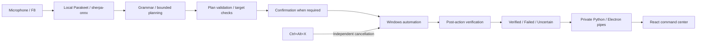

<div align="center">

# INTENTRA

### Your Voice. Your Desktop. Your Intent.

A local-first Windows voice agent that turns spoken intent into guarded desktop actions, with a native command center and explicit outcome verification.


[Demo](#product-demo) ? [Install](docs/SETUP.md) ? [Architecture](docs/ARCHITECTURE.md) ? [Commands](docs/COMMANDS.md) ? [Safety](SECURITY.md)

</div>

> **Status:** source-run Windows prototype. The React/Electron shell and Python engine are implemented. Physical microphone-to-desktop acceptance remains a separate manual check. The browser preview is offline and does not control your computer.

## Product demo

| Evidence | Availability |
| --- | --- |
| Actual product video | **Pending:** add the real URL to [the demo guide](docs/DEMO.md) |
| Product screenshots | **Pending review:** [capture slots](assets/screenshots/README.md) |
| Voice execution GIF | **Pending:** [recording instructions](assets/demo/README.md) |

No simulated outcome or UI screenshot is presented as proof of desktop execution. Local preview captures remain excluded until reviewed.

## What is Intentra?

Desktop work repeats small actions across applications: opening a browser, switching windows, navigating folders, and entering text. Intentra connects spoken commands to a constrained Windows automation engine. Unlike a chatbot that only describes a task, it can act on approved applications and inspect the result.

Starting an action does not establish success. Intentra distinguishes verified, failed, and uncertain outcomes. Ambiguous targets and unsupported controls can stop a task.

## Verified implementation

These capabilities are present in code; they do not establish universal application compatibility or completed live acceptance.

| Capability | Implementation and boundary |
| --- | --- |
| Local recognition | Parakeet TDT 0.6B v3 int8 through sherpa-onnx; CPU inference, local models |
| Voice capture | F8 hold-to-talk/release-to-submit; optional hands-free mode |
| Intent processing | Deterministic grammar and bounded workflows; optional loopback Ollama planner |
| Desktop actions | Approved app/window control; specialized Chrome, Notepad and Explorer behavior |
| Text and keyboard | Guarded input into identified safe controls; sensitive targets can be blocked |
| Confirmation | F9 approves, F10 denies; existing voice yes/no handling |
| Emergency stop | Ctrl+Alt+X independently latches shutdown; explicitly restart afterward |
| Command center | React/Electron dashboard, floating overlay, ephemeral history and settings |
| Verification | Post-action evidence; uncertainty never means success |

Signed distribution, a public browser simulation and browser-to-agent integration are **future work**. No Bolna API integration was found in the current code.

## How it works



The shell manages one Python child through private inherited pipes. It exposes lifecycle controls and telemetry, not an arbitrary OS command API. [Architecture and trust boundaries](docs/ARCHITECTURE.md).

## Technology stack

| Layer | Actual technologies |
| --- | --- |
| Speech | Python, NumPy, sounddevice, sherpa-onnx, local Parakeet |
| Automation | pywinauto/UI Automation, PyAutoGUI, bounded native workers |
| Planning/safety | Python grammar, typed plans, allowlists, confirmation, verification |
| Shell | Electron 45, isolated preload, private child-process transport |
| UI | React 19, TypeScript, Vite 8, Tailwind 4, Motion, Zustand, Zod, Radix Dialog, Lucide, Geist |
| Tests | pytest, Vitest, Testing Library, Node test runner, TypeScript, Prettier |

## Quick start

Use Windows 10/11 x64, Python 3.12, Node 24, npm, and a normal non-admin account. Copy the real clone URL from GitHub's **Code** menu; a repository URL is not guessed here.

```powershell
$repositoryUrl = Read-Host 'Paste the Intentra GitHub HTTPS clone URL'
git clone $repositoryUrl intentra
cd intentra
py -3.12 -m venv backend/.venv-win
backend/.venv-win/Scripts/python.exe -m pip install -r backend/requirements-desktop.txt
if (!(Test-Path backend/.env)) { Copy-Item .env.example backend/.env }
```

Before running, supply the four Parakeet model files under `backend/models/sherpa-onnx-nemo-parakeet-tdt-0.6b-v3-int8/`. [Exact filenames, configuration and prerequisites](docs/SETUP.md).

```powershell
cd frontend
npm ci
npm start
```

Click **Start voice agent**, wait for Ready, hold F8, speak, and release. Do not run a separate CLI agent simultaneously. `npm run build` needs neither Python nor model weights.

## Voice commands

| Say | Expected result, subject to policy/target checks |
| --- | --- |
| Open Chrome / Open Notepad | Launch or activate approved application |
| Switch to Chrome | Focus a unique approved window |
| Go to claude.ai | Navigate approved Chrome to a validated public destination |
| Type Hello from Intentra | Enter literal text into a supported safe editor |
| Open File Explorer / Go to Downloads | Supported Explorer navigation |
| Press Enter | Guarded keyboard input; may submit content |
| Stop / Cancel / Abort | Cancel after speech recognition returns |

[Command boundaries](docs/COMMANDS.md). Voice stop is not a substitute for the physical emergency shortcut.

## Keyboard controls

| Key | Behavior |
| --- | --- |
| Hold / release **F8** | Record / submit once in push-to-talk mode |
| **F9** / **F10** | Approve / deny the pending request |
| **Ctrl+Alt+X** | Emergency shutdown; restart explicitly afterward |
| **Ctrl+K** | UI command palette, not general typed automation |

Keep the target focused. Confirmation keys may also reach the foreground application.

<details>
<summary><strong>Repository map</strong></summary>

```text
intentra/
  README.md / CONTRIBUTING.md / SECURITY.md
  .env.example / .gitignore
  GITHUB_READY_CHECKLIST.md / GITHUB_SUBMISSION_REPORT.md
  Start-Intentra-OS.cmd
  assets/       # Reviewed public media slots
  docs/         # Current guides and audit
  frontend/     # React, Electron, frontend tests
  backend/      # Python engine, safety, tests, release tooling
  scripts/      # Safe repository checks
```

Historical engine reports remain under `backend/`. [Documentation index](docs/README.md).

</details>

## Testing

```powershell
cd frontend
npm test
npm run typecheck
npm run check:format
npm run build
cd ../backend
.venv-win/Scripts/python.exe -m pip install -r requirements-dev.txt
.venv-win/Scripts/python.exe -m pytest -q --basetemp temp/github-validation
cd ..
backend/.venv-win/Scripts/python.exe scripts/check_docs.py
```

No ESLint rule set is configured. Prettier checks formatting, not semantic lint. [Actual preparation results](GITHUB_SUBMISSION_REPORT.md). Hardware acceptance is separate and opt-in.

## Safety and limitations

Use disposable content and review confirmations. Intentra is not a security sandbox. Permissions, models, foreground focus, accessibility trees and app versions affect behavior. Generic UIA discovery does not guarantee editing support. Automated saving and arbitrary-caret Notepad append are not claimed. The shell is source-run, not a signed installer.

Audio is not saved by default; DEBUG_RECORDING changes this. Desktop history is bounded and in memory; redaction is best-effort. [Security](SECURITY.md) ? [Limitations](backend/docs/KNOWN_LIMITATIONS.md).

## Bolna Buildathon submission

Intentra demonstrates local voice recognition, constrained intent processing, target-aware automation and separately verified outcomes. Its engineering focus is the boundary between understanding a command and safely acting on it.

Judges can inspect the architecture, run tests and follow the [live evaluation script](docs/DEMO.md). Add the actual working video before submission. Targeting the Bolna Buildathon does not imply Bolna API integration.

## Roadmap

- [x] Local Parakeet and F8 capture implementation
- [x] Guarded automation, confirmation and emergency stop
- [x] React/Electron command center and private telemetry
- [ ] Recorded physical acceptance and reviewed screenshots
- [ ] Clean-machine validation and signed distribution
- [ ] Clearly labeled browser simulation and public landing experience
- [ ] Future remote integration with explicit pairing and local consent

## Maintainers and license

The repository owner should add their preferred public author/profile attribution before submission; none is selected in the current documentation.

**No project license is included.** The owner must choose and approve one before describing this as licensed open-source software. Dependency and model licenses are separate; review redistribution rights before bundling them.
